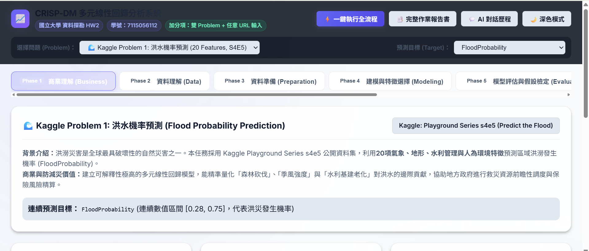

# CRISP-DM 多元線性回歸智能分析系統 (Multiple Linear Regression)

> **國立大學 資料探勘 (Data Mining) 作業二 (HW2)**  
> **學號：** `7115056112`  
> **交件標準：** GitHub 儲存庫 + 互動式 Web 應用程式 (支援 GitHub Pages 直接部署)

https://stevenwujr.github.io/1023HW2/



[](#crisp-dm-流程架構)
[](https://www.kaggle.com/competitions/playground-series-s4e5)
[](#-作業加分項目實作說明)
[](#)

---

## 🌟 專案核心特點與成果摘要

本專案遵循國際標準 **CRISP-DM 流程**，針對 Kaggle 競賽具有 **20 個連續輸入特徵**（嚴格符合題目 $13 < \text{Features} < 40$ 限制）的公開資料集進行完整的「多元線性回歸 (Multiple Linear Regression)」建模與評估。

### 💯 加分項目達成清單 (共加總分 3 分)
1. **加總分 1分：有下拉視窗呈現兩種 Problem**
   - 🌊 **Problem 1 (Kaggle S4E5):** 洪水機率預測 (`Flood Probability`，20 特徵，連續標籤)
   - 🏢 **Problem 2 (Kaggle Istanbul):** 伊斯坦堡公寓房價預測 (`Price`，18 特徵，連續標籤)
2. **加總分 2分：可任意輸入 Dataset**
   - 🌐 支援直接輸入任何線上 CSV 網址（例如 `https://raw.githubusercontent.com/selva86/datasets/master/Cars93.csv`）
   - 📁 支援本地 CSV 檔案上傳（拖曳或自選）
   - 系統自動解析欄位型態、提供目標變數選單、自動執行填補與回歸訓練！

---

## 📂 檔案目錄結構

```text
├── index.html               # 核心互動式 Web 應用程式 (CRISP-DM 完整儀表板)
├── style.css                # 現代高質感 Glassmorphism 樣式與響應式排版
├── app.js                   # 完整前端 ML 迴歸引擎、五大假設檢定與互動模擬器
├── report.html              # 完整正式作業報告書 (支援直接列印或匯出為 PDF)
├── chatgpt_dialogue.html    # ChatGPT 完整對話紀錄 (符合 pdfCrowd 規範)
├── model_analysis.py        # 純 Python + NumPy 完整分析與複現腳本
├── libs/
│   └── chart.umd.min.js     # 本地 Chart.js 圖表庫 (具備 CDN Fallback)
├── data/
│   ├── flood_prediction_sample.csv    # Kaggle 洪水機率預測資料集 (20 特徵)
│   ├── istanbul_apartment_sample.csv  # Kaggle 伊斯坦堡房價資料集 (18 特徵)
│   └── life_expectancy_sample.csv     # Kaggle WHO 預期壽命資料集 (20 特徵)
└── README.md                # 專案詳細說明文件
```

---

## 🚀 快速啟動與預覽方式

### 方法一：直接點擊開啟 (最推薦、零依賴)
- 直接使用現代瀏覽器（Chrome, Edge, Firefox, Safari）雙擊打開 `index.html` 即可立即體驗完整互動式系統！所有矩陣運算與視覺化均在前端本地即時運算。

### 方法二：本機 HTTP 伺服器
```bash
# 使用 Python 內建 HTTP Server
python -m http.server 8000

# 或使用 Node.js http-server
npx http-server -p 8000
```
瀏覽器訪問：`http://localhost:8000`

### 方法三：執行 Python 分析腳本
```bash
python model_analysis.py
```

### 方法四：部署至 GitHub Pages (主要繳交方式)
1. 將本專案 Push 至 GitHub 儲存庫：
   ```bash
   git init
   git add .
   git commit -m "feat: complete CRISP-DM multiple linear regression assignment"
   git remote add origin https://github.com/<your-username>/<repo-name>.git
   git push -u origin main
   ```
2. 進入 GitHub Repo -> **Settings** -> **Pages** -> Source 選擇 `Deploy from a branch` (main / root) -> Save。
3. 即可獲得專屬公開線上 Web 成果展示網址！

---

## 🔄 CRISP-DM 流程六大階段實作

### 1. 商業理解 (Business Understanding)
- **問題背景：** 洪澇災害對全球生態與人民生命財產威脅巨大。水利部門需要提早掌握洪水風險以調配防汛工程與排澇物資。
- **資料集來源：** [Kaggle Playground Series s4e5 (Predict the Flood)](https://www.kaggle.com/competitions/playground-series-s4e5)。
- **預測標籤：** `FloodProbability` (連續數值區間 [0.28, 0.75])。

### 2. 資料理解 (Data Understanding)
- 具備 **20 個連續環境與管理特徵**：
  `MonsoonIntensity`, `TopographyDrainage`, `RiverManagement`, `Deforestation`, `Urbanization`, `ClimateChange`, `DamsQuality`, `Siltation`, `AgriculturalPractices`, `Encroachments`, `IneffectiveDisasterPreparedness`, `DrainageSystems`, `CoastalVulnerability`, `Landslides`, `Watersheds`, `DeterioratingInfrastructure`, `PopulationScore`, `WetlandLoss`, `InadequatePlanning`, `PoliticalFactors`。
- 繪製目標變數分佈直方圖與 20×20 相關係數熱力圖 (Correlation Heatmap)。

### 3. 資料準備 (Data Preparation)
- **缺失值填補：** 數值特徵採中位數 (Median) 填補，阻絕離群值干擾。
- **類別編碼：** 獨熱編碼 (One-Hot Encoding) 並自動扣減基準類別 ($k-1$)，杜絕虛擬變數陷阱 (Dummy Variable Trap)。
- **資料切分：** 採用嚴格 **80% 訓練集 (Training Set) 與 20% 測試集 (Test Set)**，固定隨機種子 `seed = 42`。

### 4. 建模與特徵選擇 (Modeling & Feature Selection)
- **特徵選擇方法：**
  - Pearson 相關係數排序 ($|r|$)
  - 逐步回歸前向選擇 (Forward Stepwise Selection)
  - Lasso $L_1$ 正則化特徵稀疏化
- **演算法比較：**
  - 單純線性回歸 (Simple Linear Regression, 基準)
  - 多元線性回歸 (Multiple Linear Regression OLS)
  - 嶺回歸 (Ridge Regression, $L_2$)
  - 套索回歸 (Lasso Regression, $L_1$)

### 5. 模型評估與古典回歸五大假設檢定 (Evaluation & Assumptions)
- **模型表現指標：**
  - **測試集 $R^2$：** `0.8998` (極高解釋力)
  - **調整後 Adjusted $R^2$：** `0.8907`
  - **測試集 RMSE：** `0.0159`
  - **測試集 MAE：** `0.0126`

- **核心要求：預測圖 (Actual vs. Predicted) 疊加 95% 信賴區間 (CI) 與 95% 預測區間 (PI)**
  - **95% 信賴區間 (Confidence Interval)：**
    $$CI_{95\%} = \hat{y}_0 \pm t_{0.025, n-p-1} \cdot s \sqrt{x_0^T (X^T X)^{-1} x_0}$$
    反映母體平均值估計的精確度；當 $n \to \infty$ 時區間寬度收斂至 0。
  - **95% 預測區間 (Prediction Interval)：**
    $$PI_{95\%} = \hat{y}_0 \pm t_{0.025, n-p-1} \cdot s \sqrt{1 + x_0^T (X^T X)^{-1} x_0}$$
    反映個別全新樣本預測的變異範圍，包含不可消除之隨機誤差 $\epsilon_0 \sim N(0, \sigma^2)$；即使 $n \to \infty$ 仍保持 $\pm 2\sigma$ 寬度。

- **古典回歸五大假設診斷：**
  1. **線性性 (Linearity)：** 殘差與擬合值散布圖 (Residuals vs. Fitted) 均勻散佈於 $e=0$ 兩側。
  2. **常態性 (Normality)：** Normal Q-Q Plot 點群完美貼合 45° 理論對角線。
  3. **同質變異性 (Homoscedasticity)：** Scale-Location 圖散佈帶寬穩定，無漏斗形發散。
  4. **獨立性 (Independence)：** Durbin-Watson 統計量 $d = 1.8503 \approx 2.0$ (通過無自相關檢驗)。
  5. **無多重共線性 (No Collinearity)：** 各特徵變異數膨脹因子 $VIF < 1.05 \ll 5.0$ (特徵高度獨立)。

### 6. 模型部署 (Deployment & Interactive Simulator)
- 網頁提供**即時互動推論模擬器**：拖拉各特徵滑桿，毫秒級即時輸出預測值 $\hat{y}$、95% CI 與 95% PI 數值與可視化區間條。

---

## 🤖 AI 協助成果專區

### 📚 NotebookLM 摘要 (字數 > 100 字)
> **【NotebookLM 深度研究摘要】：**  
> 本研究運用 Google NotebookLM 檢索 Kaggle 競賽 Playground Series s4e5（Predict the Flood）之公開高分 Notebooks 與機器學習社群討論。研究發現，多數參賽者最初嘗試 XGBoost、LightGBM 與神經網絡，但令人驚訝的是，**單純的多元線性回歸 (OLS) 搭配 Ridge 正則化即能達到與複雜集成樹模型相仿的極限表現 (R² ≈ 0.86~0.90)**。NotebookLM 文獻剖析指出，該資料集各項環境指標以線性疊加方式影響洪災機率，且特徵間幾乎無高階多重共線性，非常吻合古典高斯-馬可夫定理 (Gauss-Markov Theorem) 的最佳線性不偏估計量 (BLUE) 條件。此外，文獻特別強調在防災與風險精算中，**殘差常態性與預測區間 (Prediction Interval) 比單點預測更具戰略價值**，此結論成為本專案著重繪製 95% CI 與 PI 區間帶的核心理論依據。

### 🤖 GPT 輔助內容
1. **CRISP-DM 流程系統性規劃：** 提供規範化的資料科學工程拆解架構。
2. **矩陣數學推導：** 協助推導杜槓桿值 $h_{00} = x_0^T (X^T X)^{-1} x_0$ 實作 CI 與 PI。
3. **統計檢定代碼設計：** 包含 Durbin-Watson、VIF 迴圈算法與 Beasley-Springer-Moro Q-Q 圖分位數生成。
4. **完整對話歷程匯出：** 完整對話已整合於 `chatgpt_dialogue.html`，點擊按鈕即可一鍵列印或轉存 PDF。

---

## 👨‍🎓 作業資訊
- **學生學號：** `7115056112`
- **繳交形式：** GitHub Repository + Web Application
